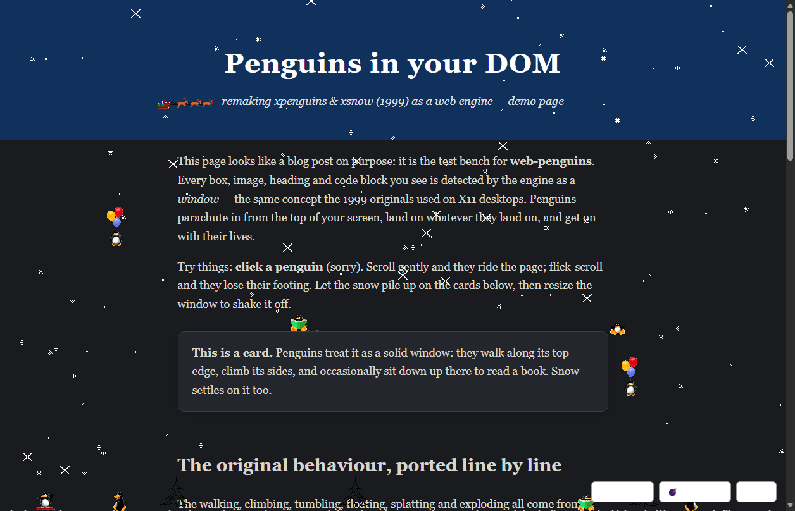

# web-penguins 🐧❄️

**xpenguins (1999) and xsnow (1984) remade for the web, with the original pixel art.**

Penguins parachute in from the top of your screen, walk along the tops of your
DOM elements, climb their sides, tumble off edges, occasionally sit down to
read a book — and yes, they splat. Snow falls, drifts in the wind, and settles
on your cards, code blocks and headings. Santa flies by.



The engine treats **DOM elements as X11 windows**: the same world model the
originals used on 1999 desktops, re-derived from any web page. It ships as a
drop-in `<script>` for your own site and as a Manifest V3 browser extension
for everyone else's.

## Quick start

One line, zero configuration:

```html
<script src="webpenguins.js" data-auto></script>
```

With options:

```html
<script src="webpenguins.js" data-auto
        data-penguins="10" data-trees="3" data-santa="big"></script>
```

Or programmatically (also available as an ES module, `webpenguins.esm.js`):

```js
const flock = WebPenguins.start({ penguins: 8, snow: true, santa: "medium" });

flock.setPenguins(20);       // more!
await flock.stop();          // the classic exit: everyone lights a bomb 💣
```

### Options

| option                 | default    | what it does |
| ---------------------- | ---------- | ------------ |
| `penguins`             | `25`       | flock size, up to 80 |
| `snow`                 | `true`     | `false`, `true`, or a flake count |
| `santa`                | `"big"`    | `false`, `"regular"`, `"medium"`, `"big"` (original xsnow sizes & speeds) |
| `rudolf`               | `true`     | Rudolf leads the sled |
| `trees`                | `0`        | tannenbaums standing on the glass floor at the screen bottom |
| `moon`                 | `false`    | the xsnow moon, top right |
| `blood`                | `true`     | allow splat/zap deaths; set `false` for the child-friendly mode (`--no-blood` in the original) |
| `angels`               | `true`     | exploded penguins ascend |
| `zapOnClick`           | `true`     | clicking a penguin zaps it |
| `scale`                | `1`        | sprite scale; `1` = the original sizes, `2` for chunky pixels |
| `snowColor`            | `"auto"`   | snow-white on dark pages, soft slate on light pages |
| `respectReducedMotion` | `true`     | do nothing if the user prefers reduced motion |

Page authors can hint the surface scanner:
`data-webpenguins="solid"` forces an element to be a platform,
`data-webpenguins="ignore"` excludes it (and its descendants).

Wondering why penguins do (or don't) land on something? Start with
`WebPenguins.start({ debug: true, ... })`, select the element in devtools,
and run `window.__webpenguins.explain($0)` — it reports the verdict of every
gate in the surface scanner for that element.

## The extension

`extension/` is a Manifest V3 extension (Chrome, Edge, Firefox ≥ 121). Load it
via `chrome://extensions` → *Developer mode* → *Load unpacked* (or
`about:debugging` → *Load Temporary Add-on* in Firefox). The popup has flock
size, snow/Santa/trees toggles, per-site disable, and a *Bomb them all*
button. Settings sync via `storage.sync` and apply to open tabs instantly —
no background worker, no messaging, no page-visible globals.

## How it works

- **`src/toon.ts` + `src/penguins.ts`** — a line-by-line port of the Toon
  library and behaviour core from xpenguins 2.2 (`toon_core.c`,
  `xpenguins_core.c`): same collision interpolation, same 8px step height,
  same probabilities (1-in-2 climb-vs-drift, 1-in-3 splats at terminal
  velocity, 1-in-100 book readings), same window-association mechanic.
- **`src/surfaces.ts`** — the web replacement for `ToonLocateWindows()`,
  and it is style-aware: a box is only solid if it actually **paints**
  something visible — a background that differs from the effective backdrop
  behind it, a visible border/outline/shadow on any side, a gradient, or
  real replaced content (a *loaded* image, a video…). The page's true
  canvas color is resolved even when it's painted by a non-ancestor
  underlay div (google.com-style dark themes do this), so boxes the same
  color as the page stay invisible. Bare headings collide with their
  text's ink box instead of their full-width layout box, rects are clipped
  by `overflow: hidden` ancestors, rounded corners become part of the
  collision shape (see below), and boxes hidden behind other *painting*
  elements are dropped — transparent hit-test overlays don't count
  (`elementsFromPoint` sampling). The **document is the desktop**:
  everything lives in page coordinates and scrolling only moves the camera,
  so penguins stay alive whether on screen or not. Only real layout changes
  count as "windows moving" and go through the original
  association/relocation machinery — an accordion expanding into a penguin
  still squashes it, exactly like a moving X11 window. Surfaces touching the
  top of the page aren't solid (ditto the original, so toons can always drop
  in), and new arrivals parachute in just above wherever you're looking.
- **`src/masks.ts` — pixel-shaped collision.** For ``, `<canvas>` and
  inline `<svg>` elements, the engine builds a bit-packed collision mask
  from the rendered alpha, so penguins stand on the letterforms of a logo —
  not its bounding box — tumble into the gaps between glyphs, and climb the
  tall stems (verified on the google.com logo). Snow settles on the
  per-column pixel profile of the shape. This is the web version of the X11
  SHAPE extension, which the original xpenguins genuinely supported for
  shaped windows. Images are read via offscreen canvas + `getImageData`;
  inline SVGs are vector-rasterized shape-by-shape with `Path2D` +
  `getScreenCTM()` using each shape's *computed* style (CSS fills resolve
  correctly, and no image loading means CSP can't object), with a data-URI
  raster fallback for exotic content. Fully-opaque images skip the mask (a
  plain rect is identical and cheaper), fully-transparent ones stop being
  solid entirely, and cross-origin images that taint the canvas retry via
  `crossOrigin="anonymous"` before falling back to the plain rect.
  CSS `border-radius` gets the same treatment: rounded cards, pills and
  circular avatars receive a procedurally generated rounded-rect mask
  (pure math, cached per size), so penguins walk down the shoulder of a
  corner and tumble off at the visual edge — not where the rounding merely
  begins. Snow drifts settle along the curve too.
- **The glass floor** — the viewport's bottom edge is a one-way collider:
  falling penguins land on it, so on endless/infinite-scroll pages nothing
  ever falls out of sight. Gentle scrolling carries the penguins standing on
  it like an elevator; flick-scrolling drops them. It never pulls up toons
  living on surfaces below it, and the true page bottom remains the world's
  hard floor.
- **`src/snow.ts`** — xsnow: the 7 original flake sprites, gusty wind, snow
  height-maps building up on surface tops and the screen bottom, Santa at the
  original 12/25/50 px/s speeds, optional tannenbaums and moon. The
  tannenbaum is tinted at runtime just like xsnow's `-tc` option did:
  classic chartreuse on dark pages, the deeper X11 chartreuse4 on light
  ones — and the trees stand on the glass floor, so they ride along the
  visible bottom edge of the screen.
- **`src/render.ts`** — one full-viewport `<canvas>` overlay,
  `pointer-events: none`, nearest-neighbour scaling. The page is never
  mutated (the canvas hangs off `<html>`, outside `<body>` observers).
- **`tools/xpm.mjs` + `tools/png.mjs` + `tools/theme.mjs`** — a dependency-free
  XPM3 parser, PNG encoder and xpenguins theme-config parser. They convert the
  original assets losslessly and read the animation metadata (frame counts,
  speeds, terminal velocities) straight from the 2001 theme file.

## Building

```
npm install
node tools/build-assets.mjs   # vendor XPMs → assets/*.png + src/generated/assets.ts
node tools/build.mjs          # → dist/webpenguins{,.esm}.js + extension bundle & icons
npx tsc --noEmit              # typecheck
node tools/test-run.mjs       # behavioural smoke test in headless Edge (CDP, no deps)
```

`vendor/` (git-ignored) holds the original sources:

```
curl -LO http://archive.ubuntu.com/ubuntu/pool/universe/x/xpenguins/xpenguins_2.2.orig.tar.gz
curl -LO https://deb.debian.org/debian/pool/main/x/xsnow/xsnow_3.9.3.orig.tar.gz
tar -C vendor -xzf xpenguins_2.2.orig.tar.gz && tar -C vendor -xzf xsnow_3.9.3.orig.tar.gz
```

## Provenance & license

- **xpenguins 2.2** © 1999–2001 Robin Hogan — GPL-2+. The default *Penguins*
  theme sprites (walker, climber, floater, bomber, angel, reader, the
  skateboarder crew…) and the entire behaviour model.
- **xsnow** © Rick Jansen (1984–2001), continued by Willem Vermin — GPL-3.
  Flakes, Santa (all sizes, with/without Rudolf), tannenbaum, moon.
- This project: **GPL-3.0-or-later** (see `LICENSE`). Sprites are converted
  losslessly from the original XPMs; the flake masks are tinted the way xsnow
  itself painted them at runtime.

Not affiliated with the original authors — just very fond of their penguins.
